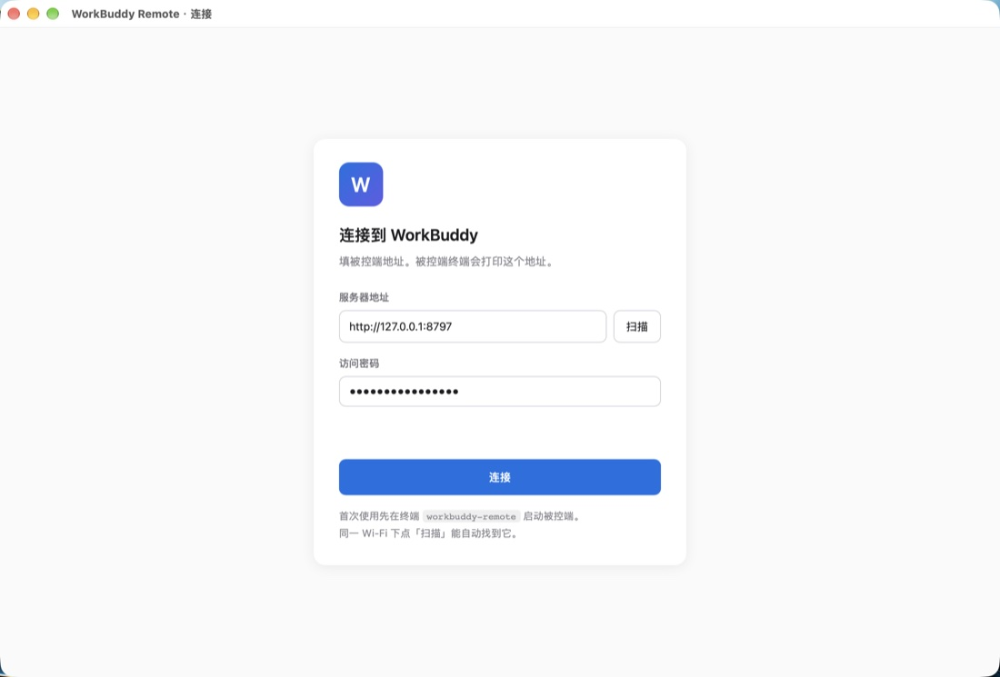

<div align="center">


# WorkBuddy Remote

**在另一台电脑上，接着用你工位上的 WorkBuddy。**

不是镜像，不是副本 —— 屏幕那头就是同一个真实会话。<br>
看思考过程、读完整回答、排队补充指令，跟坐在那台机器前没有区别。

[](https://github.com/hacksmo/workbuddy-remote/releases/latest)
[](LICENSE)
[](#已知限制)
[](#安装)
[](#同网段时自动走局域网)

</div>

<br>


<br>

## 为什么会有这个项目

我在工位上开着 WorkBuddy 跑任务，出门用笔记本想接着看 —— 然后发现做不到。

试过的路，都不通：

| 想法 | 卡在哪 |
|---|---|
| 官方多端协同 | 只能同账号**看历史**，不能操作另一台机器上**正在跑**的会话 |
| Tailscale / ZeroTier | 公司网络是对称 NAT，打洞失败后退化到境外中继，一次往返 1 秒以上，打字都卡 |
| 装个远程桌面 | RDP/VNC 传的是整屏画面，看长回答要等画面刷新，而且重 |
| 写个转发机器人 | 那就成了影子副本，上下文和真实会话对不上 |

真正的问题是：**WorkBuddy 的能力都在本机的渲染进程里**，谁也拿不走。

所以换个思路 —— 不搬能力，搬屏幕。

Electron 带 `--remote-debugging-port` 会开一个 CDP 端口，通过它可以直接在那个渲染进程里执行 JS，调用 preload 暴露的 `window.wb`。把这条路包成 HTTP，就有了一个完整的远程入口。

权限和桌面端完全一致，因为**它就是桌面端**。

<br>

## 两条路，自动选

```
同一局域网                                  →  直连，8.6ms
┌──────────┐   ────────────────────────►  ┌──────────────┐
│ 控制端    │        直连 8797              │  WorkBuddy   │
└──────────┘                               │    + 桥       │
                                           └──────────────┘

不同网络（可选）                              ┌──────────────┐
┌──────────┐  HTTPS  ┌──────────┐  SSH反向  │              │
│ 任意浏览器│ ──────► │ 中转服务器│ ◄──────── │   工作机      │
└──────────┘         └──────────┘           └──────────────┘
```

控制端启动时先探一下局域网，通就直连，不通静默回退。

实测同一条链路两个入口差 **287 倍**（8.6ms vs 2466ms），流量还不占服务器带宽。

<br>

## 装哪一端？

装错是最高频的错误 —— 在被控机上装两遍，或者在控制机上装了桥。

> **问自己一句：WorkBuddy 是装在这台机器上吗？**
>
> 是 → 装**被控端**（默认模式）　·　否 → 装**控制端**（加 `--client`）

| | **被控端**（工位那台） | **控制端**（你手上这台） |
|---|---|---|
| 装什么 | 桥 + 启动脚本 + Node.js 18+ | 一个应用图标，**不用 Node.js** |
| 命令 | `workbuddy-remote` | `workbuddy` |
| 作用 | 把本机 WorkBuddy 变成可访问的服务 | 打开指向工位的窗口 |
| 必须吗 | 必须 | 不需要 —— 浏览器输地址就行，装它只为有个独立图标 |

<br>

## 安装

### 被控端

```bash
curl -fsSL https://raw.githubusercontent.com/hacksmo/workbuddy-remote/main/install.sh | bash
```

```bash
workbuddy-remote            # 启动（会重启 WorkBuddy 开启调试端口）
workbuddy-remote --status   # 状态
workbuddy-remote --stop     # 停止
```

启动后终端打印带令牌的地址，这就是控制端要填的东西：

```
http://127.0.0.1:8797/?token=8550acac5c1b32ce...
```

> **启动会重启 WorkBuddy**，正在跑的任务会中断 —— 调试端口只能启动时指定，没法热加。
> 如果你的 WorkBuddy 本来就带 `--remote-debugging-port=9333` 启动，会跳过重启。

### 控制端 · macOS

<a href="https://github.com/hacksmo/workbuddy-remote/releases/latest/download/WorkBuddy-Remote.dmg">

</a>

双击挂载，把应用拖进「应用程序」。首次打开填地址和密码 ——



同一 Wi-Fi 下点「**扫描**」，1.4 秒内自动找到被控端，不用手抄 IP。

> **首次打开提示「无法验证开发者」？** 右键点图标选「打开」，在弹窗里再点一次「打开」。
> 只需一次 —— 应用是 ad-hoc 签名，没有 Apple 开发者证书（$99/年，个人项目没买）。

命令行装法也可以：

```bash
curl -fsSL https://raw.githubusercontent.com/hacksmo/workbuddy-remote/main/install.sh \
  | bash -s -- --client 'http://192.168.0.52:8797/?token=8550acac5c1b32ce...'
```

### 控制端 · Linux

```bash
curl -fsSL https://raw.githubusercontent.com/hacksmo/workbuddy-remote/main/install.sh \
  | bash -s -- --client 'http://192.168.0.52:8797/?token=8550acac5c1b32ce...'
```

应用菜单里出现「WorkBuddy Remote」，点开就是独立窗口（无地址栏）。

> 需要 Chrome / Edge / Brave 等 Chromium 系浏览器。都没有时退化成系统默认浏览器（有地址栏）。

<br>

## 能做什么

| | 能力 | 说明 |
|---|---|---|
| 💬 | **完整对话** | 发消息、看思考过程、读长回答，Markdown 与代码块正常渲染 |
| 📋 | **会话列表** | 按空间分组，与桌面端侧栏一致 |
| ⏹ | **中断生成** | 正在跑的任务随时叫停 |
| 🔀 | **切换模型** | 与桌面端同一套模型配置 |
| 🖼 | **贴图发送** | 直接粘贴剪贴板图片 |
| 📥 | **排队消息** | 生成期间可继续发，排队等当前回复结束 —— **和桌面端共用同一个队列** |
| ➤ | **引导会话** | 不排队，把消息插进当前正在跑的那一轮，模型不中断 |
| 🔗 | **链路指示** | 页面底部实时显示走的是局域网还是公网、延迟多少 |

> **排队消息为什么特别**：很多远程工具在这里偷懒 —— 消息拦在浏览器 localStorage 里，等回复结束再发。
> 那样被控端桌面端**完全看不到**你排了队。这里走的是 `sendPrompt()` 自己的串行链，两边共用一份真相。

<br>

## 从外网访问（可选）

需要一台有公网 IP 的服务器。推荐**反向 SSH 隧道**，不是 VPN / 内网穿透 ——

CGNAT 只阻止外部主动连入，不阻止内部主动连出。把方向反过来，NAT 类型就不再是问题。

```bash
./scripts/tunnel.sh          # 首次运行生成配置模板
vim ~/.config/workbuddy-remote/tunnel.env
./scripts/tunnel.sh
```

<details>
<summary><b>⚠️ 开全局代理的话，这一项必须配</b></summary>

<br>

`TUNNEL_BIND_IFACE` 填你的物理网卡（macOS 一般 `en0`）。

不填的后果：SSH 走代理出口，路径变成 `本机 → 代理 → 中转 → 代理 → 本机` 四跳，
实测延迟从 110ms 涨到 1 秒以上。

判断方法：

```bash
ssh -i ~/.ssh/id_ed25519 ubuntu@1.2.3.4 'echo $SSH_CLIENT'
```

显示的 IP 是代理服务器而不是你家宽带，就说明绕道了。

</details>

<details>
<summary><b>⚠️ DNS 必须是灰云</b></summary>

<br>

Cloudflare 开橙云会缓冲 SSE，实时推送直接失效。用「仅 DNS」模式。

</details>

<br>

## 配置

全走环境变量，不改代码：

| 变量 | 默认 | 说明 |
|---|---|---|
| `WB_PORT` | `8797` | 桥的 HTTP 端口 |
| `WB_HOST` | `auto` | 监听地址。`auto` = 回环 + 所有局域网 IP |
| `WB_LAN` | `1` | 设 `0` 关掉局域网监听，只留回环 |
| `WB_CDP_PORT` | `9333` | WorkBuddy 调试端口 |
| `WB_TOKEN` | 自动生成 | 存在 `~/.config/workbuddy-remote/token`（600） |
| `WB_APP` | 自动探测 | WorkBuddy 可执行文件路径 |

```bash
WB_PORT=9000 workbuddy-remote      # 换端口
WB_LAN=0 workbuddy-remote          # 只走隧道，不让同网段访问
```

<br>

## 工作原理

三件事拼起来：

1. WorkBuddy 以 `--remote-debugging-port=9333` 启动 —— Electron 开出 CDP 端口
2. `bridge/cdp.mjs` 通过 CDP 连进渲染进程，在里面执行 JS，直接调 `window.wb`
3. 把能力包成 HTTP —— 会话、消息、发送、模型、中断、文件预览

### 关键 API

| 操作 | 调用 |
|---|---|
| 列会话 | `wb.conversations.list()` |
| 读消息 | `(await wb.conversations.get(id)).requestEntries()` |
| 发消息 | `(await wb.conversations.get(id)).sendPrompt(blocks)` |
| 中断 | `(await wb.conversations.get(id)).cancel()` |
| 读队列 | `.queueManager.items()` |
| 队列操作 | `.queueManager.move(id, idx)` / `.delete(id)` / `.sendNow(id)` |
| 切模型 | `wb.invoke('wb:conversations:configSetModel', id, model)` |

### 改代码前该知道的坑

- **运行态是 `streaming`，不是 `working`** —— 判断是否在生成必须用 `streaming`
- **`create()` 返回句柄不是 id** —— 建会话要靠创建前后 `list()` 的差集拿 id
- **`requests()` 在流式期间会阻塞** —— 读消息用 `requestEntries()`
- **并发 evaluate 会串线** —— CDP 连接必须共享，evaluate 要串行排队
- **`sendNow` 是「引导」不是「打断」** —— 名字有迷惑性。它不中断模型，而是把消息插进当前轮。真中断用 `cancel()`
- **排队必须走后端** —— 别在浏览器里维护队列，见上文

### 性能处理

| 手段 | 效果 |
|---|---|
| 连接复用 + 串行队列 | `/health` 从 30ms → **1.2ms** |
| 增量拉取（`?tail=3`） | 流量 362KB → **39.5KB** |
| SSE 推送 + 轮询兜底 | 延迟 **400ms** 内，空闲降频到 15s |
| 消息裁剪 | 单条截断 6000 字，只取最近 16 条 |

<br>

## macOS 客户端为什么是原生壳


早期版本是「bash 脚本 + Chrome `--app`」。两个死结，改 plist 解决不了：

| 症状 | 根因 |
|---|---|
| Dock 里没有图标 | 图标归属**进程**。脚本不连 WindowServer，`exec` 成 Chrome 后进程身份变成 Google Chrome |
| 点一次多一个窗口 | Chrome `--app=` **没有单实例语义**，已有实例时只是「新开一个窗口」 |

也试过 Chrome PWA 的 `app_mode_loader` —— `CrAppModeUserDataDir` 会被截断到第一个空格，报 `No suitable profile found.`。

竞品印证：Fluid / Unite 是原生 WebKit，Pake 是 Tauri，WebCatalog / Rambox 是 Electron，
Nativefier 已归档。**没有一个用脚本开浏览器。**

改成 250KB 的原生壳后，单实例、Dock 图标、Cmd+Tab、「点一下收起再点一下回来」全部由 AppKit 免费提供。

<details>
<summary><b>壳的几处细节（都是踩过的）</b></summary>

<br>

- **必须实现 `WKUIDelegate`** —— 不实现时 `confirm()` **静默返回 false**。删除会话的二次确认会永远失败，表现是「点了没反应」。`alert()` / `prompt()` / 文件选择面板同理会废掉
- **必须声明 `CFBundleLocalizations`** —— 不声明时 `Bundle.main.localizations` 是空数组，`preferredLocalizations` 回退 `["en"]`，WebKit 右键菜单全英文。系统里明明有中文资源
- **不用 `setFrameAutosaveName`** —— autosave 记录里带「上次所在屏幕」，多显示器恢复出屏外坐标（实测 `Y=-971`）。自己算
- **用 `NSScreen.screens.first` 不用 `NSScreen.main`** —— 后者是「接收键盘事件的屏」，多屏时会指到外接屏
- **`isReleasedWhenClosed = false`** —— 否则关窗后引用悬空，点 Dock 直接崩溃
- **交叉编译 x86_64 要带 `-Xlinker -U -Xlinker '__swift_FORCE_LOAD_$_swiftCompatibility56'`** —— CLT 的兼容库只有 arm64 切片

</details>

<br>

## 目录结构

```
workbuddy-remote/
├── install.sh              一键安装（server / client 双角色）
├── bridge/cdp.mjs          CDP 桥 + HTTP 服务
├── web/index.html          Web UI（单文件，无构建）
├── macos/
│   ├── shell.swift         原生壳（AppKit + WKWebView）
│   ├── build-dmg.sh        打 DMG（通用二进制 + 图标 + 签名）
│   └── NOTES.md            踩坑记录
├── scripts/
│   ├── start.sh            被控端启动器
│   ├── autostart.sh        开机自启
│   └── tunnel.sh           反向 SSH 隧道
└── deploy/nginx.conf.example
```

<br>

## 安全

这东西本质是「把工位的 WorkBuddy 开放给网络上的某个人」，请认真对待：

- **默认监听局域网**（`WB_HOST=auto`）。同网段的人能访问端口，但仍需令牌。介意就 `WB_LAN=0`
- **令牌走 URL 参数**，会留在浏览器历史。公用设备建议换成更长的随机串
- **`/preview/` 能读本机文件，必须鉴权**。别把它加进免鉴权白名单 —— 那等于把整个 `Documents`/`Desktop`/`Downloads` 对全 WiFi 开放
- **公网暴露时不要用 `WB_HOST=0.0.0.0`** —— 那会监听所有网卡，包括未来的新网络。用默认的 `auto` 或显式写 IP

<br>

## 已知限制

- **只支持 macOS / Linux** —— Windows 的 WorkBuddy 安装路径和进程模型没测过
- **必须重启一次 WorkBuddy** —— 调试端口只能启动时指定
- **历史分页未做** —— 一次最多取 16 条，很长的会话得去桌面端看
- **非图片附件未支持** —— `resource_link` 类型的附件在网页端显示不出来

<br>

## 国内网络

`cdn.jsdelivr.net` 和 `raw.githubusercontent.com` 在部分网络下会在 TLS 握手阶段被重置（`curl: (35)`）。只影响**图标下载**，功能不受影响。

脚本内置镜像链，按命中率排序逐个试：

```
cdn.jsdelivr.net → ghproxy.net → gh-proxy.com → raw(sha) → raw(main) → ghfast.top
```

全失败就用内嵌的 128px 兜底图（肉眼可见变糊，功能正常）。想手动补：

```bash
WB_ICON_URL='https://你的地址/icon-512.png' bash install.sh --client '...'
```

<br>

## 卸载

```bash
# 被控端
workbuddy-remote --stop
./scripts/autostart.sh uninstall
rm -rf ~/.local/share/workbuddy-remote ~/.config/workbuddy-remote
rm -f ~/.local/bin/workbuddy-remote

# 控制端
rm -rf "$HOME/Applications/WorkBuddy Remote.app"
rm -f ~/.local/bin/workbuddy ~/.config/workbuddy-remote/lan-endpoint
```

<br>

## 常见问题

<details>
<summary><b>点了图标打开是白屏</b></summary>

<br>

说明连上了但页面挂了。查 `http://<被控端>:8797/health` 是否返回 `{"ok":true}`，
再看被控端的 `~/.config/workbuddy-remote/logs/bridge.log`。

</details>

<details>
<summary><b>Linux 点应用菜单没反应</b></summary>

<br>

终端跑一次 `~/.local/bin/workbuddy` 看输出。常见原因是找不到 Chrome ——
脚本支持 Chrome / Edge / Brave / Chromium，都没有时退回系统默认浏览器。

</details>

<details>
<summary><b>SSH 里起的图形程序一断开就没了</b></summary>

<br>

`nohup ... &` 会被会话结束带走，用 `setsid`：

```bash
setsid gtk-launch workbuddy-remote </dev/null >/tmp/wb.log 2>&1 &
```

</details>

<details>
<summary><b>Ubuntu 空闲锁屏后远程看不到窗口</b></summary>

<br>

```bash
loginctl unlock-session <id>          # 先用 loginctl list-sessions --no-legend 找 seat0
import -window root /tmp/shot.png     # 截图（ImageMagick）
```

</details>

<br>

---

<div align="center">

MIT License<br>
<sub>做这个东西的原因是：<b>我只是想在沙发上把工位上那个任务看完。</b></sub>

</div>