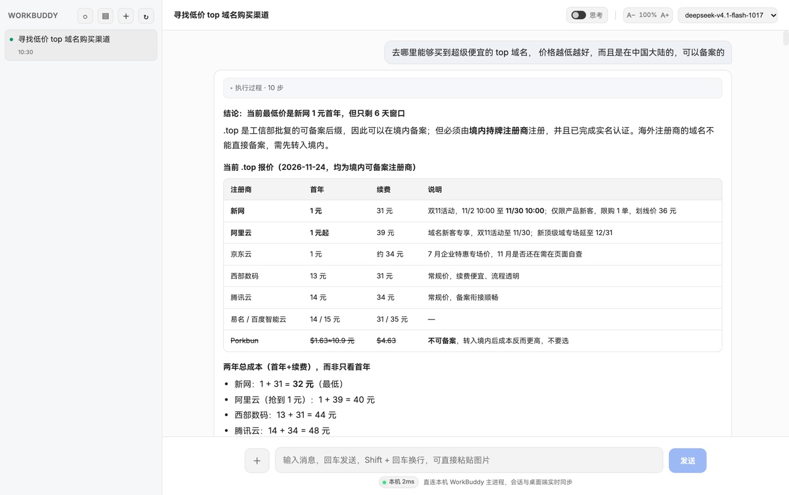
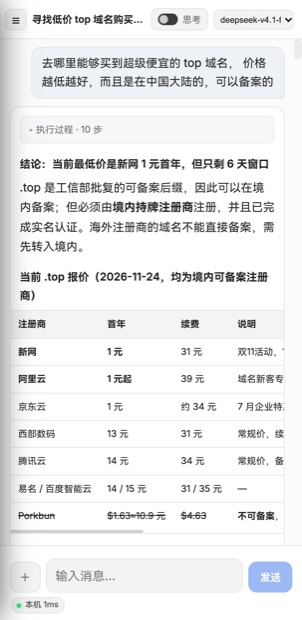

<div align="center">


# WorkBuddy Remote

**用手机、平板，或任何一台电脑的浏览器，接着用工位上那台机器里的 WorkBuddy。**

不是镜像，不是副本 —— 你看到的就是同一个真实会话。<br>
能看思考过程、能读完整回答、能排队补充指令，和坐在那台机器前没有区别。

[](https://github.com/hacksmo/workbuddy-remote/releases/latest)
[](LICENSE)
[](#三步上手)
[](#同网段时自动走近路)

</div>

<br>



<br>

<p align="center">

</p>

<p align="center"><sub>手机上打开是同一个界面，侧栏收成抽屉，表格可以横向划。</sub></p>

<br>

## 它解决什么

WorkBuddy 跑在工位那台机器上。你一出门，那些正在跑的任务就看不见了 ——
出门前发出的一句「帮我查一下」，路上想知道进度，只能等回到工位。

官方多端协同能看历史，但看不了**另一台机器上正在跑**的会话；
远程桌面能看，但传的是整屏画面，滚动长回答要等画面刷新，手机上也难用。

这个项目换个思路：**不搬能力，直接把那个界面开给你。**
在被控机上跑一个小服务，你就能在任意设备的浏览器里打开它 —— 同一个会话、同一份队列、同一个进度。

<br>

## 三步上手

### 一、在 WorkBuddy 那台机器上装

```bash
curl -fsSL https://raw.githubusercontent.com/hacksmo/workbuddy-remote/main/install.sh | bash
```

> **问自己一句：WorkBuddy 是装在这台机器上吗？**
> 是 → 就是这一步，装的是**被控端**。
> 不是 → 你要装的是控制端，见下面「想要一个像 App 的图标」。

### 二、启动

```bash
workbuddy-remote
```

终端会把它能用的地址全列出来，每条都带着密码：

```
访问地址
  （仅本机）
  http://127.0.0.1:8797/?token=8550acac5c1b32ce...

  （同网段直连，免公网）
  http://192.168.0.52:8797/?token=8550acac5c1b32ce...
```

> 启动时会重启一次 WorkBuddy，正在跑的任务会中断 —— 调试端口只能启动时指定，没法热加。
> 如果你的 WorkBuddy 本来就是带调试端口启动的，会自动跳过重启。

`workbuddy-remote --status` 看运行状态，`--stop` 停掉。

### 三、随便哪台设备，浏览器打开

同一 Wi-Fi 下，用上面**「同网段直连」那条地址**，在手机、平板、另一台电脑上打开就行。
换个网络（比如出门用 4G）就看下面「从外网访问」。

<br>

## 能做什么

| | 能力 | 说明 |
|---|---|---|
| 💬 | **完整对话** | 发消息、看思考过程、读长回答，Markdown 和代码块正常显示 |
| 📋 | **会话列表** | 按空间分组，和桌面端侧栏一致 |
| ⏹ | **随时叫停** | 跑偏了立刻中断 |
| 🔀 | **切换模型** | 与桌面端同一套配置 |
| 🖼 | **粘贴图片** | 剪贴板里的图直接发 |
| 📥 | **排队消息** | 生成期间可以继续发，排在后面等，**和桌面端共用同一个队列** |
| ➤ | **插话引导** | 不排队，把消息塞进当前这一轮，模型不中断，边跑边纠方向 |
| 🔗 | **链路提示** | 页面底部实时显示走的是局域网还是公网、延迟多少 |
| 📱 | **手机可用** | 窄屏自动收侧栏，表格可横向划，躺沙发上也能看 |
| 🖥 | **预览面板** | 会话里产出的 HTML、图片、本机文件，右侧直接打开看 |

<br>

## 几个想得比较细的地方

### 同网段时自动走近路

控制端启动时先探一下局域网，通就直连，不通静默回退到公网，你不用管。
同一条链路两个入口实测差 **287 倍**（8.6ms vs 2466ms），而且直连不占服务器带宽。

### 排队消息和桌面端是同一份

很多远程工具在这里偷懒：把消息先存在浏览器里，等回复结束再发出去。
后果是你排在队里的消息，**坐在那台机器前的人完全看不到**。

这里排队走的是 WorkBuddy 自己的队列，两边看的是同一份真相 ——
你在手机上排的三条，回到工位打开桌面端，它们还在队列里等着。

### 走公网也不卡

用反向隧道而不是内网穿透。原因是：公司和运营商的网络通常只拦「外面主动连进来」，
不拦「里面主动连出去」。把方向反过来，这类网络就不再是问题，
不用跟 NAT 类型较劲，也不用装客户端。

页面数据是增量推送的，一条长回答在往上滚的时候不会整段重传。

### 不会把你的东西暴露给全公司

默认监听局域网，但**没有密码进不来**；密码自动生成，存在本机、权限 600。
介意同网段可见就 `WB_LAN=0`，只留隧道。

### 手机上也真的能用

不是「能打开」就算数。窄屏下侧栏收成抽屉，点开点一下会话自动收回；
输入框字号设成 16px，否则 iOS 聚焦时会自己放大页面；
长表格改成横向滚动，而不是把中文一列压成一个字一行。

<br>

## 想要一个像 App 的图标？（可选）

浏览器打开已经能用了。如果你想像正常应用一样 —— Dock 里有图标、Cmd+Tab 能切、
点一下收起再点一下回来 —— 那就在**你手上这台**装一个控制端。

> 注意：控制端**不需要** Node.js，也不用装 WorkBuddy，它只是一个窗口。
> 装错是最常见的错误：在被控机上装两遍，或者在控制机上装了桥。

### macOS

<a href="https://github.com/hacksmo/workbuddy-remote/releases/latest/download/WorkBuddy-Remote.dmg">

</a>

双击挂载，把应用拖进「应用程序」。首次打开填地址和密码 ——


同一 Wi-Fi 下点「**扫描**」，一秒多就能自动找到被控端，不用手抄 IP。

> **首次打开提示「无法验证开发者」？** 右键点图标选「打开」，弹窗里再点一次「打开」。
> 只需一次 —— 应用没有买 Apple 的开发者证书（$99/年，个人项目没买）。

### Linux

```bash
curl -fsSL https://raw.githubusercontent.com/hacksmo/workbuddy-remote/main/install.sh \
  | bash -s -- --client 'http://192.168.0.52:8797/?token=8550acac5c1b32ce...'
```

应用菜单里出现「WorkBuddy Remote」，点开是独立窗口，没有地址栏。

> macOS 也可以用同一条命令装，效果和上面的 DMG 一样，只是没有图标美化。

<br>

## 从外网访问（可选）

需要一台有公网 IP 的服务器，最省事的是几十块一个月的轻量云。

```bash
./scripts/tunnel.sh          # 首次运行生成配置模板
vim ~/.config/workbuddy-remote/tunnel.env
./scripts/tunnel.sh          # 再跑一次就连上
```

脚本会建一条反向 SSH 隧道，把被控端的端口映射到你的域名。
之后在任何网络下用 `https://你的域名/?token=...` 都能打开。

<details>
<summary><b>⚠️ 开了全局代理的话，这一项必须配</b></summary>

<br>

`TUNNEL_BIND_IFACE` 填你的物理网卡（macOS 一般是 `en0`）。

不填的后果：隧道会走代理出口，路径变成「本机 → 代理 → 中转 → 代理 → 本机」四跳，
实测延迟从 110ms 涨到 1 秒以上，打字能感觉到滞后。

判断方法：

```bash
ssh -i ~/.ssh/id_ed25519 ubuntu@1.2.3.4 'echo $SSH_CLIENT'
```

显示的 IP 是代理服务器而不是你家宽带，就说明绕道了。

</details>

<details>
<summary><b>⚠️ 域名解析要关掉橙云</b></summary>

<br>

如果域名托管在 Cloudflare，必须用「仅 DNS」模式（灰云）。
开了橙云会缓冲实时推送，页面就变成要手动刷新才有新内容。

</details>

<br>

## 配置

全走环境变量，不用改代码：

| 变量 | 默认 | 说明 |
|---|---|---|
| `WB_PORT` | `8797` | 服务端口 |
| `WB_HOST` | `auto` | 监听地址。`auto` = 本机 + 所有局域网地址 |
| `WB_LAN` | `1` | 设 `0` 关掉局域网监听，只留本机 |
| `WB_TOKEN` | 自动生成 | 密码，存在 `~/.config/workbuddy-remote/token`（600） |

```bash
WB_PORT=9000 workbuddy-remote      # 换端口
WB_LAN=0 workbuddy-remote          # 只走隧道，不让同网段访问
```

<br>

## 安全

这东西本质是「把工位的 WorkBuddy 开放给网络上的某个人」，请认真对待：

- **默认监听局域网，但没有密码进不来。** 介意同网段可见就 `WB_LAN=0`
- **密码走网址参数**，会留在浏览器历史里。公用设备上建议换成一串更长的随机字符
- **公网暴露时别用 `WB_HOST=0.0.0.0`** —— 那会监听所有网卡，包括以后新接入的网络。
  用默认的 `auto`，或者显式写死 IP
- **文件预览接口能读本机文件，必须带密码。** 别把它加进免密码白名单 ——
  那等于把整个「文档 / 桌面 / 下载」对全公司开放

<br>

## 常见问题

<details>
<summary><b>点了图标打开是白屏</b></summary>

<br>

说明连上了但页面没起来。先看 `http://<被控端>:8797/health` 是不是返回 `{"ok":true}`，
再看被控端的 `~/.config/workbuddy-remote/logs/bridge.log`。

</details>

<details>
<summary><b>提示连不上 WorkBuddy</b></summary>

<br>

大多数情况是 WorkBuddy 没带调试端口启动。`workbuddy-remote --stop` 再重新 `workbuddy-remote` 一次
（会重启 WorkBuddy，正在跑的任务会中断）。

</details>

<details>
<summary><b>手机打开很慢，或者一直转圈</b></summary>

<br>

先确认手机和那台机器是不是同一个 Wi-Fi（同名 Wi-Fi 的 2.4G / 5G 有时是两张网）。
页面底部有链路提示，写着公网的话说明没走近路。

</details>

<details>
<summary><b>安装时下载图标失败（curl: (35)）</b></summary>

<br>

部分网络下访问 GitHub / CDN 会在握手阶段被重置。只影响**图标**，功能不受影响 ——
脚本内置了多条镜像会自动重试，全失败就用内嵌的兜底图（看着糊一点，能正常用）。

想手动补一张：

```bash
WB_ICON_URL='https://你的地址/icon-512.png' bash install.sh --client '...'
```

</details>

<details>
<summary><b>SSH 里起的图形程序一断开就没了</b></summary>

<br>

`nohup ... &` 会被会话结束带走，用 `setsid`：

```bash
setsid gtk-launch workbuddy-remote </dev/null >/tmp/wb.log 2>&1 &
```

</details>

<br>

## 已知限制

- **被控端需要 macOS / Linux** —— 也就是装着 WorkBuddy 的那台机器。
  **你用来访问的设备不受限制**，手机、平板、Windows、另一台 Mac 都行，有浏览器就能用
- **必须重启一次 WorkBuddy** —— 调试端口只能启动时指定
- **很长的会话看不全** —— 一次取最近 16 条，更早的要去桌面端翻
- **非图片附件显示不出来** —— 文档类附件在网页端还没有渲染

<br>

## 它是怎么做到的

WorkBuddy 桌面端本身留了一个调试入口，可以在它自己的界面里执行脚本。
这个项目把这个入口包成普通网页 —— 你在浏览器里点一下，真正执行的地方还是那台机器上的
WorkBuddy 本体，权限、模型配置、会话队列都是它自己的，所以不存在「同步不及时」这回事。

macOS 的图标版另外做了个约 250KB 的小外壳。原因很实际：用脚本拉起浏览器拿不到 Dock 图标，
而且点两次会开出两个窗口。

<br>

## 卸载

```bash
# 被控端
workbuddy-remote --stop
./scripts/autostart.sh uninstall
rm -rf ~/.local/share/workbuddy-remote ~/.config/workbuddy-remote
rm -f ~/.local/bin/workbuddy-remote

# 控制端（装了的话）
rm -rf "$HOME/Applications/WorkBuddy Remote.app"
rm -f ~/.local/bin/workbuddy ~/.config/workbuddy-remote/lan-endpoint
```

<br>

---

<div align="center">

MIT License<br>
<sub>做这个东西的原因是：<b>我只是想在沙发上把工位上那个任务看完。</b></sub>

</div>